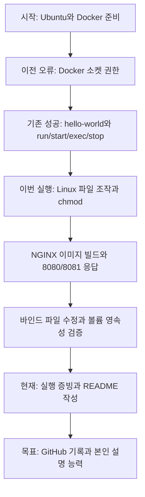
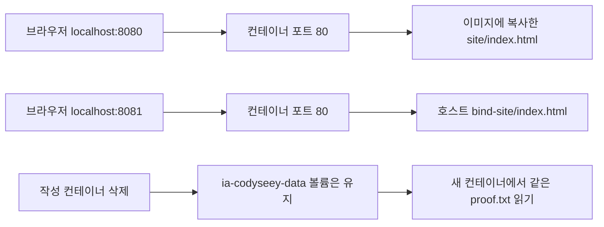

# ia-codyseey
Github과 Codyseey를 연동하기 위해 만들어진 Repository입니다.

## 개발환경 실습 결과

2026-11-08, 실제 Windows PC의 WSL2 Ubuntu에서 에이전트가 명령을 대신 실행하고 검증했습니다. 사용자가 직접 모든 명령을 입력했다는 의미는 아닙니다. 기존 학습 일지는 [노션](https://app.notion.com/p/4122013c95c2813581bcc30ba2472b0a)에 보존했습니다.

### 시작부터 현재까지



### 무엇을 실행했나

| 과제 | 실제 결과 | 증거 |
| --- | --- | --- |
| Linux CLI | mkdir, touch, cat, cp, mv, rm, rmdir, ls -la 성공 | [전체 실행 로그](evidence/lab.log) |
| chmod | 파일 644에서 실행 실패, 755에서 executable-ok. 디렉터리 755에서 700 변경 | 같은 로그의 stat 출력 |
| 커스텀 이미지 | NGINX 기반 Dockerfile 빌드 성공 | [Dockerfile](Dockerfile), 빌드 로그 |
| 8080 | IMAGE_VERSION_1 응답 | [응답 원문](evidence/8080.html) |
| 8081 바인드 마운트 | 파일 수정 후 재빌드 없이 BIND_VERSION_2 반영 | [변경 전](evidence/bind-before.html), [변경 후](evidence/bind-after.html) |
| Docker stats | 두 서버 CPU 0.00%, 메모리 11.38 MiB 및 11.17 MiB | 한 시점의 측정값이며 성능 보증 아님 |
| 볼륨 영속성 | 작성 컨테이너 삭제 후 새 컨테이너에서 같은 내용과 SHA-256 확인 | lab.log의 volume-before와 volume-after |
| 브라우저 | 실제 Chrome에서 두 페이지의 한국어 제목과 서로 다른 버전 표시 확인 | 브라우저 관찰, 별도 PNG 미저장 |
| VS Code | WSL 확장 설치, Ubuntu 서버 설치, 저장소 폴더 열기 확인 | [실제 화면](evidence/vscode-wsl.png) |
| Git | 기존 main 복제, 저장소 범위 작성자 설정 | [추가 로그](evidence/troubleshooting.log) |

VS Code는 `WSL: Ubuntu` 연결이 확인됐지만 **Restricted Mode**입니다. 폴더 신뢰 여부는 사용자가 판단할 부분이며, 편집기 안의 실행과 Source Control 전체 동작까지 완료했다고 주장하지 않습니다. Git 커밋과 업로드는 터미널에서 진행합니다.

### 구조를 이해하기



두 웹 서버는 이 PC의 127.0.0.1에만 연결했습니다. `8080:80`에서 앞은 PC가 받는 포트이고 뒤는 컨테이너 안의 NGINX 포트입니다. `EXPOSE 80`만으로 PC의 포트가 열리지는 않습니다.

바인드 마운트는 내가 편집하는 폴더를 연결합니다. 이번에는 컨테이너에서 호스트 파일을 바꾸지 못하도록 readonly로 연결했고, 호스트에서 바꾼 내용은 즉시 보였습니다. 볼륨은 Docker가 관리하는 별도 저장소입니다. 컨테이너 삭제와 볼륨 삭제는 서로 다르며, 이번 실습에서는 볼륨을 삭제하지 않았습니다.

볼륨 파일 내용은 `persistent-value-20261108`이고 삭제 전후 SHA-256은 모두 다음과 같았습니다.

```text
931a80e1d5640d79bab0866aeafa3e9a15cac3cd09b6c6e1b4f37514dbafca0b
```

### 트러블슈팅 1: 실행 권한 없는 파일

학습을 위해 의도적으로 재현한 오류입니다. `chmod 644 hello.sh` 상태에서 `./hello.sh`를 실행하자 `Permission denied`가 발생했습니다. 파일을 읽을 권한과 실행할 권한이 다르기 때문입니다. `chmod 755 hello.sh` 이후 같은 명령이 `executable-ok`를 출력했습니다. 근거는 lab.log에 실패와 해결이 함께 남아 있습니다.

### 트러블슈팅 2: 이미 사용 중인 컨테이너 이름

학습을 위해 의도적으로 재현한 오류입니다. 실행 중인 `ia-codyseey-web-8080`과 같은 이름으로 `docker run`을 다시 호출하자 이름 충돌로 종료 코드 125가 나왔습니다. `run`은 새 컨테이너를 만들기 때문입니다. 기존 컨테이너를 조회하고 HTTP 응답을 확인해 정상 동작 중임을 검증했습니다. 이미 실행 중이면 재사용하고, 중지된 기존 컨테이너라면 `docker start`를 사용합니다. 기존 컨테이너를 무작정 삭제하지 않았습니다. 근거는 troubleshooting.log입니다.

### 이전 종료 코드 137 추가 확인

기존 `exec-practice`는 이번에도 ExitCode 137이었고 `OOMKilled=false`였습니다. Docker가 기록한 OOM 종료는 아니지만, 이것만으로 SIGKILL의 발생 경로를 확정할 수는 없습니다. 이전 stop의 제한 시간 만료 가능성은 가설로 남겨 둡니다.

### 다시 확인하는 방법

Ubuntu에서 저장소 폴더를 연 뒤 아래 명령으로 현재 상태를 볼 수 있습니다.

```bash
docker ps -a
docker stats --no-stream ia-codyseey-web-8080 ia-codyseey-web-8081
curl -fsS http://localhost:8080
curl -fsS http://localhost:8081
docker volume inspect ia-codyseey-data
git log -1 --oneline
git status --short
```

[scripts/lab.sh](scripts/lab.sh)는 이번에 실제 실행한 순서입니다. 처음 실행하는 환경용이며 같은 이름의 컨테이너가 남아 있으면 다시 실행할 때 이름 충돌이 납니다. 실습 전체를 반복하기 전에 컨테이너와 볼륨의 보존 여부를 판단해야 합니다. 이 파일을 실행하면 이미지 다운로드, 컨테이너 생성, 실습용 컨테이너 삭제가 일어납니다.

### 내가 공부할 순서

1. **위치와 권한**: pwd, ls -la로 현재 위치와 권한을 읽고 644와 755의 차이를 설명하기. 디렉터리의 x는 접근과 탐색에 필요합니다.
2. **이미지와 컨테이너**: Dockerfile은 제작법, 이미지는 만들어진 실행 재료, 컨테이너는 실제 실행 단위라고 구분하기.
3. **run, start, exec**: 새로 만들기, 기존 것 켜기, 켜진 것 안에서 추가 명령 실행하기를 구분하기.
4. **포트**: localhost:8081 요청이 컨테이너의 80번으로 들어가는 경로 그려보기.
5. **저장 위치**: 이미지에 복사한 파일, 바인드 파일, 볼륨 파일이 어디에 있는지 설명하기.
6. **Git**: diff로 변경 확인, add로 포함할 파일 선택, commit으로 이력 저장, push로 GitHub 반영이라는 순서 익히기.

핵심 확인 질문: 왜 8081의 문구만 바뀌었을까요? 왜 컨테이너를 지워도 proof.txt가 남았을까요? 이 두 질문에 자기 말로 답하면 이번 실습의 핵심을 이해한 것입니다.

### 검증 범위와 남은 일

- 실제 명령 출력과 편집기 화면을 증빙으로 보관했습니다. 기록용 예상 출력을 성공 증거로 사용하지 않았습니다.
- 이전 실습은 기존 노션 기록과 현재 남아 있는 컨테이너 상태를 참고했습니다. 이전 행동 전체를 이번에 재실행한 것은 아닙니다.
- VS Code 폴더 신뢰 선택, 편집기 내부 Git 조작, 교육기관 제출 화면에서 최종 제출 여부는 미확인입니다.
- 사용자 본인의 독립 수행과 개념 이해는 아직 평가하지 않았습니다.
- 웹 컨테이너 두 개와 실습 볼륨은 복습을 위해 남겨 두었습니다. 중지하려면 `docker stop ia-codyseey-web-8080 ia-codyseey-web-8081`을 사용할 수 있습니다.

### 공식 참고 자료

- [Docker 바인드 마운트](https://docs.docker.com/engine/storage/bind-mounts/)
- [Docker 볼륨](https://docs.docker.com/engine/storage/volumes/)
- [VS Code WSL 연결](https://code.visualstudio.com/docs/remote/wsl)

위 문서는 2026-11-08 확인했습니다. 결과 표는 공식 문서의 예제가 아니라 이 PC에서 얻은 결과입니다.
