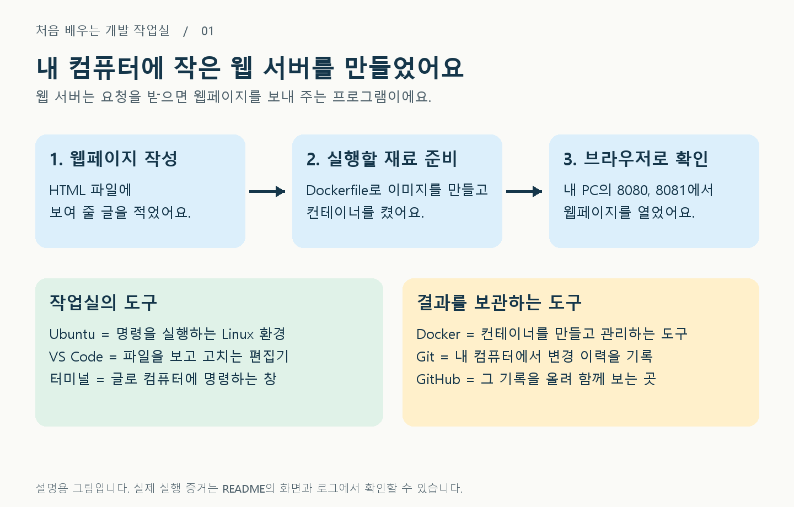
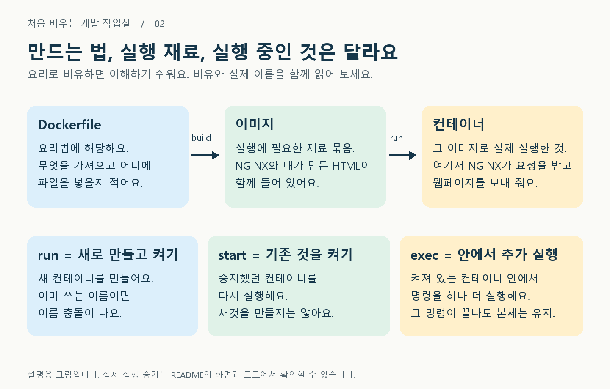
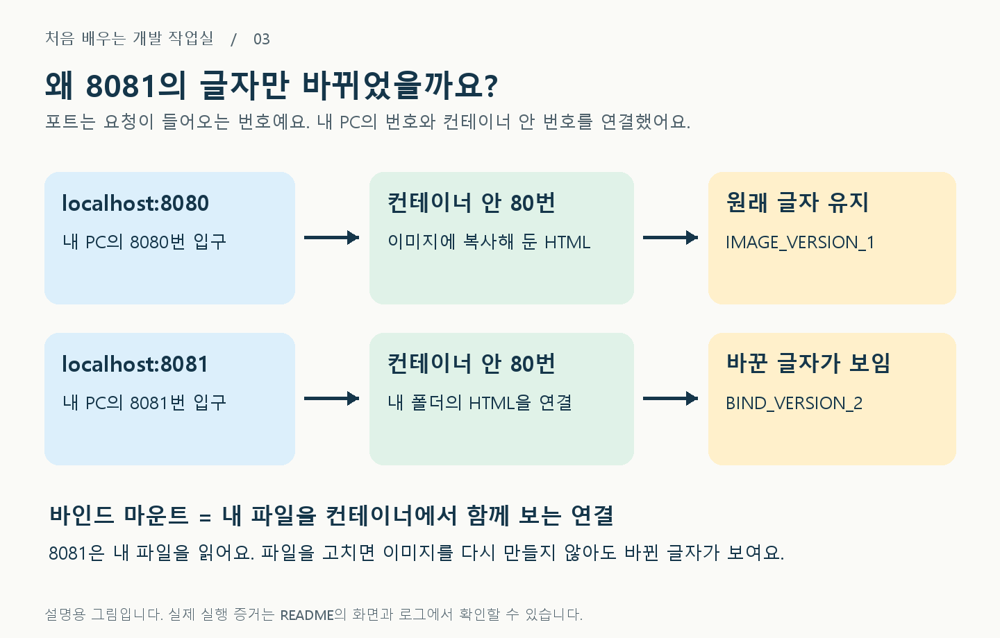
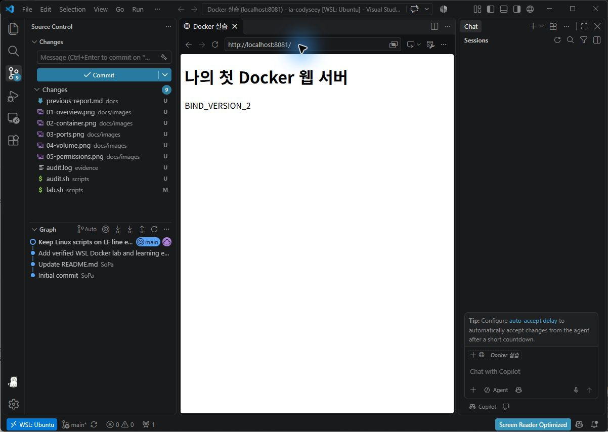
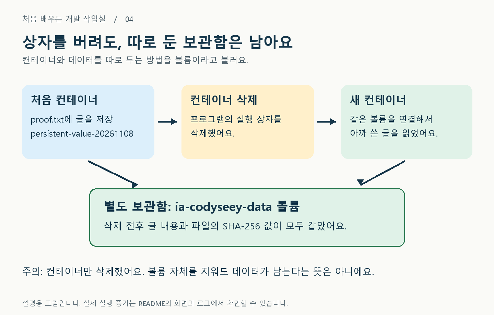
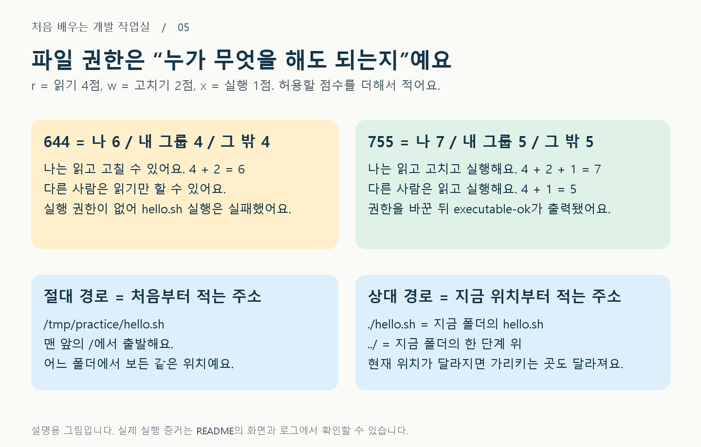
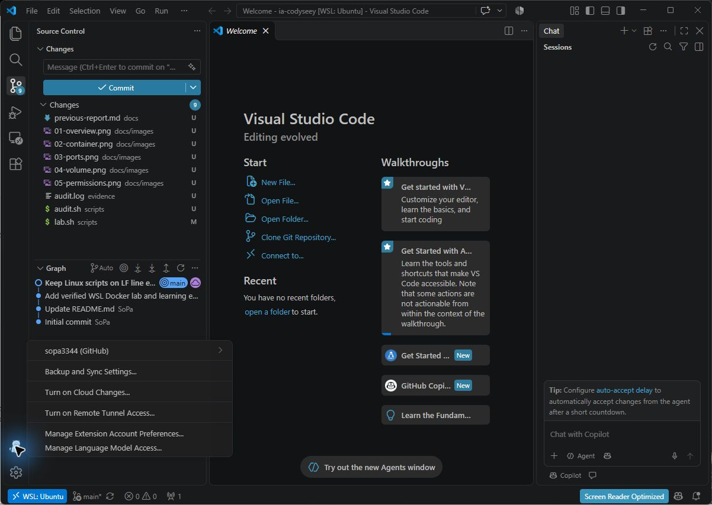

# 내 컴퓨터에 작은 웹 서버 만들기

**웹페이지를 만들고, 내 컴퓨터에서 켜 보고, 파일을 바꿔 보고, 기록까지 GitHub에 올린 실습입니다.**

처음에는 아래 그림부터 읽으세요. 명령어를 외우지 않아도 괜찮습니다. 먼저 내가 만든 것과 결과를 이해하고, 그다음 한 단계씩 따라 해 보면 됩니다.



> 이 저장소는 원래 GitHub와 Codyssey를 연결하기 위해 만들었습니다. 실습은 2026-11-08 실제 Windows PC의 WSL2 Ubuntu에서 에이전트가 대신 실행했습니다. 아래 그림은 설명용이고, 실행 증거는 별도 화면과 로그입니다. 사용자가 모든 명령을 직접 입력했다거나 이해 평가를 통과했다고 주장하지 않습니다.

## 1. 무엇을 만들었나요?

웹 서버는 브라우저가 “페이지를 보여 줘”라고 요청하면 HTML 파일을 보내 주는 프로그램입니다. HTML은 웹페이지에 들어갈 글과 구조를 적은 파일입니다.

이번에는 **NGINX**라는 웹 서버를 사용했습니다. 읽는 법은 “엔진엑스”입니다. 이미 준비된 NGINX에 내가 만든 HTML을 넣어서, 내 페이지를 보여 주는 서버로 바꿨습니다.



실제로 작성한 [Dockerfile](Dockerfile)은 세 줄입니다.

```dockerfile
FROM nginx:stable-alpine
COPY site/index.html /usr/share/nginx/html/index.html
EXPOSE 80
```

| 줄 | 쉬운 뜻 | 왜 필요한가요? |
| --- | --- | --- |
| FROM | 준비된 NGINX 재료를 가져와요 | 웹 서버를 처음부터 설치하지 않기 위해서예요 |
| COPY | 내가 만든 HTML을 서버가 읽는 위치에 넣어요 | NGINX 기본 화면 대신 내 글을 보여 줘요 |
| EXPOSE | 이 컨테이너는 80번 포트를 사용한다고 적어요 | 실제 PC 연결은 다음의 `-p` 설정으로 해요 |

## 2. 두 웹 화면은 무엇이 다른가요?



`localhost`는 **지금 이 컴퓨터**라는 뜻입니다. `8080`과 `8081`은 요청이 들어오는 입구 번호입니다.

- **8080**: 이미지를 만들 때 복사한 파일을 보여 줍니다. `IMAGE_VERSION_1`이 보입니다.
- **8081**: 내 컴퓨터의 `bind-site/index.html`을 연결해서 보여 줍니다. 이 파일을 수정하자 `BIND_VERSION_2`로 바뀌었습니다.

내 폴더를 연결하는 것을 **바인드 마운트**라고 합니다. 이미지를 다시 만들지 않아도 수정한 내용이 보였습니다. 이번 연결은 `readonly`여서 컨테이너에서 내 파일을 고칠 수는 없지만, 내가 PC에서 고친 내용은 읽을 수 있습니다.

[8080 응답 원문](evidence/8080.html) / [8081 변경 전](evidence/bind-before.html) / [8081 변경 후](evidence/bind-after.html)

아래는 **VS Code 내장 브라우저에서 직접 연 실제 화면**입니다. 위쪽 주소창의 포트와 아래 응답을 함께 확인할 수 있습니다. 설명용 그림이나 합성 화면이 아닙니다.




## 3. 컨테이너를 지웠는데 왜 글이 남았나요?



컨테이너는 실행 상자이고, **볼륨은 따로 둔 보관함**이라고 생각하면 됩니다. 처음 컨테이너가 보관함에 글을 썼습니다. 그 컨테이너를 삭제한 뒤 새 컨테이너가 같은 보관함을 열었습니다. 글은 그대로 남아 있었습니다.

```text
삭제 전: persistent-value-20261108
삭제 후: persistent-value-20261108
```

내용이 같은지 더 정확히 비교하려고 SHA-256도 확인했습니다. SHA-256은 파일 내용으로 계산하는 긴 비교 값입니다. 삭제 전후 모두 다음 값이었습니다.

```text
931a80e1d5640d79bab0866aeafa3e9a15cac3cd09b6c6e1b4f37514dbafca0b
```

## 4. 파일 권한과 경로도 연습했어요



숫자는 순서대로 **파일 주인 / 파일의 그룹 / 그 밖의 사람**에 대한 권한입니다. 그림의 “나”는 파일 주인을 뜻합니다. 폴더에서 `x`는 프로그램 실행 대신 그 폴더 안으로 들어가고 경로를 따라가는 권한입니다.

실습에서 파일은 `644 → 755`, 폴더는 `755 → 700`으로 바꿨습니다. `700`은 주인에게만 읽기, 쓰기, 접근을 허용한다는 뜻입니다.

## 5. 이미 만든 결과를 내가 직접 보는 방법

### ① 웹페이지 보기

Docker Desktop이 실행 중일 때, 브라우저의 **위쪽 주소창**에 다음 주소를 하나씩 입력합니다. 다른 사람의 PC에서는 이 주소로 제 서버가 보이지 않습니다.

```text
http://localhost:8080
http://localhost:8081
```

성공하면 두 화면 모두 “나의 첫 Docker 웹 서버”가 보이고, 아래 버전 글자만 다릅니다.

### ② 켜져 있는지 확인하기

Windows 시작 메뉴에서 **Ubuntu**를 열고 다음 한 줄을 입력한 뒤 Enter를 누릅니다. 아래 코드에는 `$` 표시를 넣지 않았으므로 보이는 명령만 복사하면 됩니다.

```bash
docker ps -a
```

`ia-codyseey-web-8080`과 `ia-codyseey-web-8081`을 찾으세요. `Up`이면 켜져 있고 `Exited`이면 꺼져 있습니다. 꺼져 있다면 아래 명령으로 기존 것을 다시 켭니다.

```bash
docker start ia-codyseey-web-8080 ia-codyseey-web-8081
```

목록에 이름이 아예 없다면 새로 만들어야 하므로 아래 “처음부터 다시 만들기”로 갑니다. 이미 존재하는 컨테이너에 `run`을 다시 쓰면 이름 충돌이 납니다.

### ③ 컴퓨터 자원을 얼마나 쓰는지 보기

```bash
docker stats --no-stream ia-codyseey-web-8080 ia-codyseey-web-8081
```

CPU는 계산 장치를 얼마나 쓰는지, MEM은 메모리를 얼마나 쓰는지 보여 줍니다. 숫자는 매번 달라지는 것이 정상입니다. 최초 실습에서는 메모리가 약 11 MiB씩이었습니다.

### ④ 보관함의 글 읽기

```bash
docker run --rm --mount type=volume,source=ia-codyseey-data,target=/data,readonly ubuntu cat /data/proof.txt
```

`persistent-value-20261108`이 나오면 성공입니다. 잠깐 만든 읽기용 컨테이너는 `--rm` 때문에 끝나면 없어집니다. 기존 볼륨은 남습니다.

## 6. 처음부터 다시 만들기

이 부분은 **Docker Desktop과 WSL Ubuntu가 준비된 새 환경**을 위한 절차입니다. Ubuntu 안에 `git`, `curl`, `bash`가 있어야 하고 `docker version`에 Client와 Server가 모두 나와야 합니다.

### ① 작업 파일 받기

Ubuntu 터미널에서 원하는 작업 폴더로 이동한 뒤 입력합니다. `git clone`은 GitHub의 파일과 이력을 내 PC로 가져오는 명령입니다.

```bash
git clone https://github.com/sopa3344/ia-codyseey.git
cd ia-codyseey
pwd
ls -la
```

`Dockerfile`, `site`, `scripts`, `README.md`가 보여야 합니다. 이미 같은 폴더가 있으면 다시 clone하지 말고 그 폴더로 들어가세요.

### ② 이미지를 만들기

```bash
docker build -t ia-codyseey-web:lab .
```

마지막 `.`은 “지금 폴더의 파일을 사용해”라는 뜻입니다. 성공하면 이미지 이름 `ia-codyseey-web:lab`이 생깁니다. 처음에는 NGINX 다운로드 때문에 시간이 걸릴 수 있습니다.

### ③ 첫 서버 켜기

```bash
docker run -d --name ia-codyseey-web-8080 -p 127.0.0.1:8080:80 ia-codyseey-web:lab
curl -fsS http://localhost:8080
```

`-d`는 뒤에서 계속 실행, `--name`은 이름, `-p`는 입구 연결입니다. 이 설정은 내 PC에서만 접속하도록 127.0.0.1에 연결합니다. 응답에 `IMAGE_VERSION_1`이 있으면 성공입니다.

### ④ 내 폴더를 연결한 두 번째 서버 켜기

```bash
mkdir -p bind-site
cp site/index.html bind-site/index.html
docker run -d --name ia-codyseey-web-8081 -p 127.0.0.1:8081:80 --mount "type=bind,source=$PWD/bind-site,target=/usr/share/nginx/html,readonly" ia-codyseey-web:lab
curl -fsS http://localhost:8081
sed -i 's/IMAGE_VERSION_1/BIND_VERSION_2/' bind-site/index.html
curl -fsS http://localhost:8081
```

첫 응답은 `IMAGE_VERSION_1`, 마지막 응답은 `BIND_VERSION_2`여야 합니다. `$PWD`는 지금 폴더의 절대 경로이므로 다른 PC에서도 경로를 직접 바꿔 적을 필요가 없습니다. `sed`는 파일 안의 글자를 바꾸는 명령입니다.

### ⑤ 볼륨 실험 따라 하기

새 이름 `my-learning-data`를 사용하는 연습입니다. 이미 같은 볼륨에 다른 파일이 있다면 덮어쓰지 않도록 다른 이름으로 바꾸세요.

```bash
docker volume create my-learning-data
docker run --name my-learning-writer --mount type=volume,source=my-learning-data,target=/data ubuntu sh -c 'echo hello-volume > /data/hello.txt; cat /data/hello.txt'
docker rm my-learning-writer
docker run --rm --mount type=volume,source=my-learning-data,target=/data,readonly ubuntu cat /data/hello.txt
```

처음과 마지막에 `hello-volume`이 나오면 컨테이너 삭제 후에도 데이터가 남은 것입니다. 이 예시는 복습용 명령이며 최초 실제 결과의 글자는 `persistent-value-20261108`입니다.

전체 최초 실습은 [lab.sh](scripts/lab.sh)에 있습니다. `bash scripts/lab.sh`는 파일 권한부터 이미지, 포트, 볼륨까지 자동 실행하고 `evidence/lab.log`를 기록합니다. **수동 ②~⑤를 이미 수행한 환경에서는 이어서 실행하지 마세요.** 중복 컨테이너나 기존 실습 볼륨이 있으면 보존을 위해 중단하도록 보완했습니다. 8080/8081을 다른 프로그램이 사용한다면 그 프로그램 상태를 확인하거나 다른 포트로 바꾸세요. 현재 실행 중인 다른 컨테이너를 임의로 삭제할 필요는 없습니다.

## 7. Git과 GitHub는 무엇이 다른가요?

**Git은 내 컴퓨터의 변경 기록장, GitHub는 그 기록장을 올리는 웹사이트**입니다. VS Code는 파일을 편집하고 변경을 살펴보는 도구입니다. GitHub 로그인과 파일 업로드는 서로 다른 단계입니다.

```text
파일 수정 → diff로 차이 보기 → add로 저장할 파일 선택
         → commit으로 기록 남기기 → push로 GitHub에 올리기
```

아래는 본인 이름과 이메일을 넣어야 하는 **설정 양식**입니다. 따옴표 안의 문장을 그대로 쓰지 말고 바꿔 주세요. 공개 저장소에는 GitHub의 비공개용 noreply 이메일을 사용할 수 있습니다.

```bash
git config user.name "본인의 Git 작성자 이름"
git config user.email "본인의 Git 작성자 이메일"
git config init.defaultBranch main
git config --list
```

이 명령은 현재 저장소 범위에 적용됩니다. `init.defaultBranch`는 새 저장소를 만들 때 사용할 기본 이름이며, 이미 있는 브랜치 이름을 바꾸는 명령은 아닙니다. 이번 저장소의 실제 브랜치는 `main`입니다.

```bash
git diff
git add README.md
git commit -m "Update learning notes"
git push origin main
```

파일을 수정했을 때 쓰는 순서입니다. 아무 수정도 없다면 `nothing to commit`이 나오는 것이 정상입니다. 평가 등록 화면의 프로젝트 URL에는 `https://github.com/sopa3344/ia-codyseey`, Branch 명에는 `main`을 입력합니다. **GitHub 업로드와 교육기관의 평가 요청은 별개**입니다.

## 8. 평가자가 확인할 실제 환경과 증거

| 항목 | 확인값 |
| --- | --- |
| PC 환경 | Windows, WSL2 Ubuntu |
| Linux | Ubuntu 26.04.1 LTS, 커널 6.18.54.1-microsoft-standard-WSL2 |
| 셸과 실행 경로 | Bash 5.3.9, Windows 명령 실행 도구에서 wsl.exe로 Ubuntu Bash 호출 |
| Docker | Engine 29.9.2, Docker Desktop 4.98.0 |
| Git | Ubuntu Git 2.53.0 |
| 원격 저장소 | sopa3344/ia-codyseey, main |

버전과 결과는 실제 PC에서 읽었습니다. 다른 버전의 Docker에서는 로그 형식이 조금 다를 수 있습니다.

- [x] 파일과 폴더 조작, 숨김 파일 목록
- [x] 파일과 디렉터리 권한 변경 전후
- [x] Docker 버전, 데몬 점검, 이미지 목록
- [x] hello-world, Ubuntu 내부 명령, 실행과 중지
- [x] logs와 stats, 주 프로세스와 exec의 차이
- [x] NGINX 커스텀 이미지 빌드와 실행
- [x] 8080/8081 HTTP 응답, 바인드 변경
- [x] 볼륨 생성과 컨테이너 삭제 전후 비교
- [x] Git 작성자, 기본 브랜치, GitHub 업로드
- [x] VS Code GitHub 계정 표시와 Ubuntu 폴더 열기 관찰
- [x] 주소창 포함 웹 화면 두 장과 VS Code 연동 캡처

사용자가 폴더 신뢰를 선택한 뒤 제한 모드가 해제됐습니다. 아래 실제 화면에서 왼쪽 아래의 `sopa3344 (GitHub)`, `main` 브랜치, 변경 파일과 원격 이력을 확인할 수 있습니다. 커밋과 push는 CLI로 수행했습니다.



| 증거 | 들어 있는 내용 |
| --- | --- |
| [읽기 쉬운 실행 기록](docs/execution-evidence.md) | 명령과 실제 출력을 코드블록으로 모음 |
| [최초 실습 원문](evidence/lab.log) | CLI, chmod, 빌드, 두 포트, 바인드, stats, 볼륨 |
| [추가 점검 원문](evidence/audit.log) | OS/셸/Git 버전, docker info/images/logs, hello-world, 종료/유지, git config --list |
| [오류 재현 기록](evidence/troubleshooting.log) | 이름 충돌, 기존 서버 재사용, Git 설정 |
| [첫 VS Code 화면](evidence/vscode-wsl.png) | Ubuntu 폴더 연결, 신뢰 선택 전의 당시 상태 |
| [최종 VS Code 연결 화면](evidence/vscode-github.png) | GitHub 계정, main, 변경 파일과 Git 이력 |
| [8080 실제 화면](evidence/browser-8080.png), [8081 실제 화면](evidence/browser-8081.png) | 내장 브라우저 주소창과 각각의 응답 |
| [이전 보고서](docs/previous-report.md) | 이전 기록 보존본, 최신 상태는 이 README 우선 |

### 주 프로세스와 exec 비교 결과

추가 점검에서 `bash -c`를 주 프로세스로 실행한 컨테이너는 명령을 끝내고 `exited 0`이 됐습니다. 반면 `sleep infinity`를 주 프로세스로 켜 둔 컨테이너에서 `docker exec ... bash -c ...`를 끝내도 본체는 `running`이었습니다. 이후 stop으로 중지했습니다. [명령과 결과](docs/execution-evidence.md)를 함께 확인할 수 있습니다.

### 트러블슈팅 1: 파일이 있는데 실행되지 않음

학습용으로 의도적으로 재현한 오류입니다.

| 단계 | 기록 |
| --- | --- |
| 문제 | ./hello.sh에서 Permission denied |
| 원인 가설 | 파일은 있지만 실행 권한 x가 없을 수 있음 |
| 확인 | stat 출력이 644, 실행 권한 없음 |
| 해결 | chmod 755 hello.sh |
| 결과 | 같은 명령이 executable-ok 출력 |

### 트러블슈팅 2: 같은 이름으로 새 컨테이너를 만들 수 없음

학습용으로 의도적으로 재현한 오류입니다.

| 단계 | 기록 |
| --- | --- |
| 문제 | docker run에 Conflict, 종료 코드 125 |
| 원인 가설 | 이미 같은 이름의 컨테이너가 있을 수 있음 |
| 확인 | docker ps에 ia-codyseey-web-8080이 Up 상태 |
| 대안 | 새로 만들지 않고 기존 컨테이너 재사용 |
| 결과 | curl로 기존 서버의 정상 응답 확인 |

기존 `exec-practice`의 종료 코드 137도 조회했습니다. `OOMKilled=false`였지만 정확히 누가 강제 종료 신호를 보냈는지는 확정하지 않았습니다. 별개로 추가 실습에서는 `--init`을 사용한 컨테이너가 stop 후 143으로 끝났습니다. 서로 다른 실행 결과를 혼동하지 않습니다.

### 아직 주장하지 않는 것

사용자 본인의 독립 수행과 설명 능력, 교육기관의 평가 통과, 최종 평가 요청은 확인하지 않았습니다. 선택 과제인 Compose와 SSH 키 등록은 이번 필수 과제 범위에 포함하지 않았습니다. 이번 실습에서 웹 컨테이너 두 개와 볼륨은 복습을 위해 남겨 두었습니다.

## 9. 마지막으로 이 세 가지를 말해 보세요

1. **무엇을 만들었나요?** 내 컴퓨터에서 HTML을 보여 주는 웹 서버를 Docker로 실행했어요.
2. **왜 8081만 바뀌었나요?** 8081은 내가 수정한 폴더를 직접 연결해서 읽고 있었기 때문이에요.
3. **왜 컨테이너를 지워도 글이 남았나요?** 글을 별도 볼륨에 저장했고 그 볼륨은 지우지 않았기 때문이에요.

막히면 2번과 3번 그림으로 돌아가세요. 이 문장을 자기 말로 설명하는 것이 첫 목표입니다.

[노션 학습 일지](https://app.notion.com/p/4122013c95c2813581bcc30ba2472b0a)

공식 참고: [Docker 바인드 마운트](https://docs.docker.com/engine/storage/bind-mounts/), [Docker 볼륨](https://docs.docker.com/engine/storage/volumes/), [VS Code WSL](https://code.visualstudio.com/docs/remote/wsl). 2026-11-08 확인.
